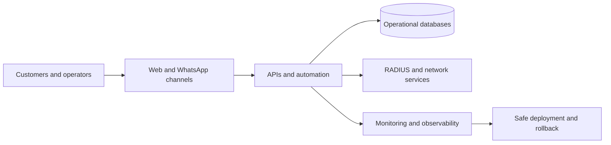

# Murilo Lucania

Founder of **MRL NET** and a technology professional working across software development, ISP infrastructure, networking, cloud operations, automation, and AI-enabled customer service.

I build and operate solutions that connect business workflows to real infrastructure: customer management, billing, authentication, support, service orders, monitoring, APIs, and messaging integrations.

## What I work with

- **Software:** JavaScript, Node.js, React, HTML, CSS, Python, REST APIs, automated tests
- **Data:** MariaDB, PostgreSQL, SQL, migrations, audit trails
- **DevOps and cloud:** Linux, VPS, Docker, Nginx, CI/CD, backups, health checks, rollback
- **Networking and ISP:** MikroTik, Cisco, Ubiquiti, RADIUS/FreeRADIUS, routing, wireless links
- **Observability:** Zabbix, Grafana, monitoring, incident analysis
- **Automation and AI:** WhatsApp, Evolution API, WAHA, Meta Cloud API, text, audio, and image processing

## Selected work

### MRL Auth

Administrative platform for an internet service provider. It brings together authentication, customers, finance, billing, plans, service orders, RADIUS operations, role-based access control, and auditable operational workflows.

### Logos

Intelligent service automation integrated with the MRL NET platform. It handles domain-based customer workflows, WhatsApp provider adapters, audio and image processing, idempotency, safe escalation, and operational reporting.

### Delivery and operations

The platform uses reproducible builds, synthetic test data, contract-based tests, immutable database migrations, secret scanning, controlled deployments, health checks, backups, and automated rollback.

> The production repository is private because it contains proprietary operational code. Public descriptions are intentionally sanitized and never include customer data, credentials, infrastructure secrets, or production logs.

## Professional background

- Founder and CEO, MRL NET — since December 2016
- Telecommunications and technology consultant, NET RUBI FIBRA — since April 2011
- Degree in Systems Analysis and Development — UNOPAR, 2019
- Bachelor's degree in Theology — UNOPAR, 2024
- Theology lecturer

## Contact

- [LinkedIn](https://www.linkedin.com/in/murilo-lucania-4301a5122/)
- [MRL NET](https://mrlnet.com.br/)
- [murilo@mrlnet.com.br](mailto:murilo@mrlnet.com.br)

Open to remote software development, DevOps, infrastructure, networking, automation, integration, and technology consulting projects.

---

## Português

Sou fundador da **MRL NET** e atuo na integração entre desenvolvimento de software, infraestrutura de provedores, redes, cloud, automação e atendimento inteligente. Desenvolvo sistemas e APIs, opero ambientes Linux e Docker, trabalho com bancos de dados, RADIUS, MikroTik, Cisco, observabilidade e integrações com WhatsApp.

Estou disponível para projetos remotos, consultorias, integrações, manutenção e desenvolvimento de soluções sob medida.
