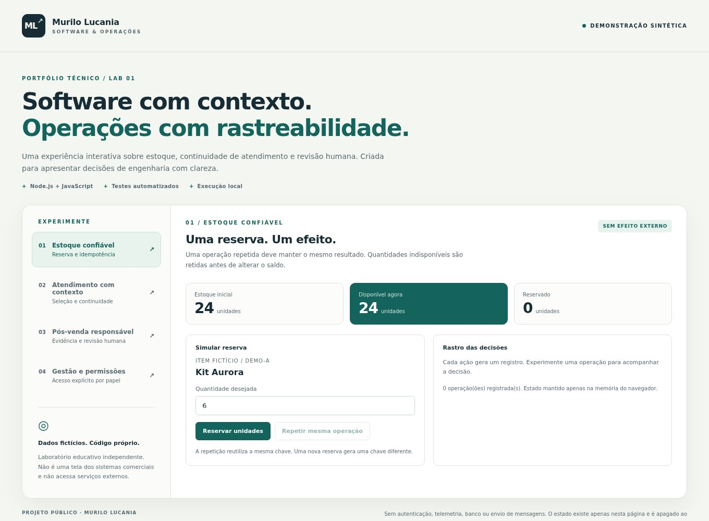

# Portfólio técnico · Murilo Lucania

Quatro estudos de caso sobre soluções que idealizo e desenvolvo, com foco em problemas, participação, decisões e evidências. O código comercial permanece privado.

| Estudo | Recorte principal | Evidência pública complementar |
| --- | --- | --- |
| [MaxiSystem](maxisystem.md) | Gestão industrial, estoque e rastreabilidade | Reserva e repetição de operação no laboratório |
| [MRL Auth](mrl-auth.md) | Gestão de provedores, autenticação e permissões | Matriz demonstrativa de acesso por papel |
| [Logos](logos.md) | Continuidade de atendimento e contexto | Seleção de referência e retomada da solicitação |
| [Bella IA](bella-ia.md) | Pós-venda e revisão humana | Ocorrência preservada após um agradecimento |

## Veja e experimente

[Vídeo curto (WebM)](../assets/lab-walkthrough.webm) · [Código e instruções do laboratório](../lab/README.md) · [Captura em celular](../assets/lab-mobile.jpg)

As imagens e o vídeo são capturas de uma **aplicação demonstrativa independente**, executada apenas com dados fictícios. Não são imagens dos produtos em produção. O código do laboratório foi escrito para publicação; nenhum módulo privado foi copiado.

## Como interpretar os resultados

Os estudos descrevem capacidades e decisões verificadas na documentação técnica dos projetos, revisada de forma privada para preparar este material. Essa revisão não é uma auditoria independente nem substitui acesso ao código comercial. Os testes públicos permitem reproduzir apenas os comportamentos do laboratório. Não publico ganhos percentuais, escala de uso ou indicadores comerciais sem medição divulgável.

Os nomes dos projetos e o contato profissional já são públicos ou foram autorizados pelo autor para este portfólio. Dados operacionais, documentos, mensagens reais, topologia, endereços de infraestrutura, certificados e credenciais não integram o material.

---

## English

Four public case studies: **MaxiSystem**, **MRL Auth**, **Logos**, and **Bella IA**. Each describes the problem, my role, selected engineering decisions, and the boundaries of the available evidence.

The screenshots and video show a separate educational application using synthetic data. No commercial source module or real operational record is included. Public tests reproduce the sample's behavior; they do not audit the private products or establish commercial performance metrics.

[Run the lab](../lab/README.md#english) · [Watch the demo](../assets/lab-walkthrough.webm)
