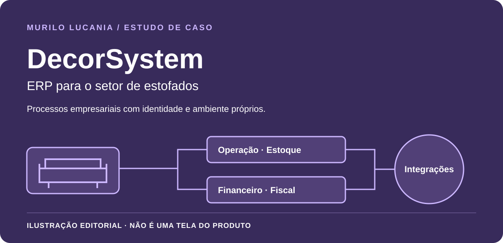

# Portfólio técnico · Murilo Lucania

[Código e execução da vitrine navegável](../showcase/README.md) · [Os seis projetos na apresentação](../assets/showcase-projects.jpg) · [Visual em celular](../assets/showcase-mobile.jpg)

A captura acima mostra a vitrine deste portfólio, não a interface de um produto comercial.

Seis sistemas distintos, com finalidades e responsabilidades próprias. Os estudos apresentam o segmento, os problemas atendidos, minha participação e decisões técnicas em alto nível. Código e interfaces comerciais permanecem privados.

| Sistema | Finalidade | Estudo próprio |
| --- | --- | --- |
| MaxiSystem | ERP para a indústria de móveis | [Conhecer o MaxiSystem](maxisystem.md) |
| FacilitaSystem | ERP para o setor de estofados | [Conhecer o FacilitaSystem](facilitasystem.md) |
| DecorSystem | Gestão empresarial para o setor de estofados | [Conhecer o DecorSystem](decorsystem.md) |
| MRL Auth | Gestão administrativa e operação de provedores | [Conhecer o MRL Auth](mrl-auth.md) |
| Logos | Automação de atendimento integrada à MRL NET | [Conhecer a Logos](logos.md) |
| Bella IA | Atendimento e pós-venda no setor moveleiro e marketplaces | [Conhecer a Bella IA](bella-ia.md) |

## Conheça cada sistema

As seis capas são ilustrações editoriais, não capturas dos produtos nem novas identidades visuais oficiais. MaxiSystem atende à indústria de móveis; FacilitaSystem e DecorSystem são projetos distintos para o setor de estofados. A Logos integra o ecossistema do MRL Auth; essa integração não torna as duas soluções um único produto. A Bella IA possui contexto de negócio próprio.

## Laboratório independente · não é uma demonstração dos produtos

[Vídeo curto (WebM)](../assets/lab-walkthrough.webm) · [Código e instruções do laboratório](../lab/README.md) · [Captura em celular](../assets/lab-mobile.jpg)

Somente esta seção apresenta capturas e vídeo do **Operational Flow Lab**, uma aplicação educativa independente com dados fictícios. O laboratório não representa nenhum dos seis produtos. Seu código foi escrito para publicação; nenhum módulo privado foi copiado.

## Como interpretar os resultados

Os estudos descrevem capacidades e decisões verificadas na documentação técnica dos projetos, revisada de forma privada para preparar este material. Essa revisão não é uma auditoria independente nem substitui acesso ao código comercial. Os testes públicos permitem reproduzir apenas os comportamentos do laboratório. Não publico ganhos percentuais, escala de uso ou indicadores comerciais sem medição divulgável.

Os nomes dos projetos e o contato profissional já são públicos ou foram autorizados pelo autor para este portfólio. Dados operacionais, documentos, mensagens reais, topologia, endereços de infraestrutura, certificados e credenciais não integram o material.

---

## English

Six distinct systems: **MaxiSystem** (furniture manufacturing ERP), **FacilitaSystem** and **DecorSystem** (distinct projects for upholstery businesses), **MRL Auth** (ISP management), **Logos** (service automation), and **Bella IA** (customer service and after-sales). Each case has its own editorial illustration, not a product screenshot or an official brand redesign. Logos integrates with MRL Auth while retaining its own responsibilities.

Only the independent lab section contains application screenshots and video. These show the Operational Flow Lab, not the six products. No commercial source module or real operational record is included. Public tests reproduce the sample's behavior; they do not audit the private products or establish commercial performance metrics.

[Run the lab](../lab/README.md#english) · [Watch the demo](../assets/lab-walkthrough.webm)
