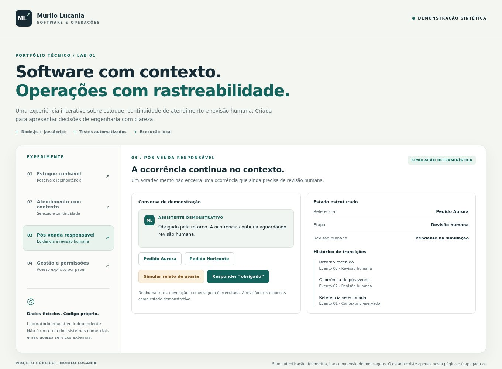

# Bella IA · Pós-venda com contexto e revisão humana

**Meu papel:** criador da solução, com atuação na definição dos fluxos e em sua evolução técnica para o setor moveleiro e marketplaces.

## Problema

O pós-venda pode combinar dúvidas sobre produto, entrega e ocorrências que exigem análise humana. Uma mensagem de cortesia não resolve uma avaria, e a ausência de informação não autoriza inventar uma previsão ou executar uma ação comercial.

## Solução e decisões

A Bella IA organiza o atendimento em domínios próprios do negócio e preserva o estado da conversa.

- manter a ocorrência e a referência relacionadas ao atendimento;
- separar informação disponível de informação que ainda precisa ser validada;
- encaminhar ocorrências sensíveis para revisão humana;
- testar diálogos completos e mudanças de assunto, além de frases isoladas;
- condicionar integrações e envios à homologação do canal e às permissões aplicáveis.

O nome da solução não implica uso de um modelo generativo em cada interação. O material público não divulga fornecedores, canais internos, corpus ou configurações de execução.

## Resultado e evidência

A documentação revisada apresenta fluxos de contexto, avaliação e revisão humana. Isso não equivale a certificação de todos os canais para atendimento automático. No laboratório público, um relato de avaria permanece pendente após um agradecimento e não é transferido para outro pedido.

**A imagem é do laboratório, não da Bella IA.** Nenhuma troca, devolução, reembolso ou mensagem é executada. Não são publicados dados de compradores, pedidos, documentos ou conversas reais.

[Executar a demonstração](../lab/README.md) · [Ler os testes de revisão](../lab/test/engine.test.mjs) · [Voltar ao portfólio](README.md)

---

## English

**Role:** solution creator, working on customer-service flows and technical evolution for furniture commerce and marketplaces.

Bella IA focuses on contextual after-sales workflows, validated information, sensitive-case escalation, and channel readiness. A courtesy reply must not silently close an unresolved occurrence or move it to another order.

The public sample verifies that human-review state survives acknowledgement and reference-switch attempts. It uses synthetic data and predefined actions, with no generative model, external messages, returns, or refunds. The case does not certify private production channels or publish buyer records.

[Public sample](../lab/README.md#english) · [Tests](../lab/test/engine.test.mjs)
