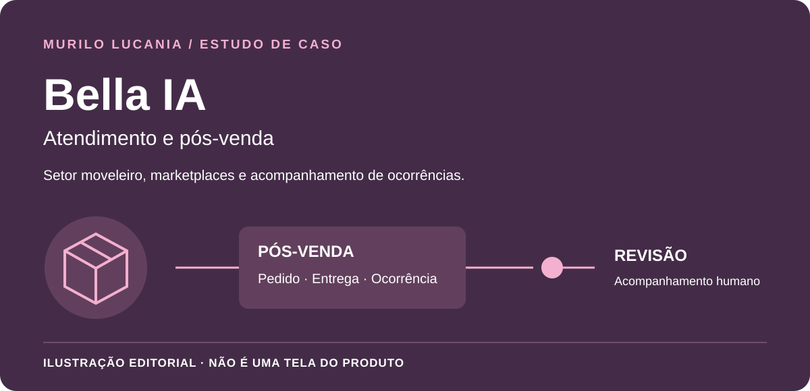

# Bella IA · Pós-venda com contexto e revisão humana

*Capa editorial deste estudo; não é uma captura da interface da Bella IA.*

**Meu papel:** criador da solução, com atuação na definição dos fluxos e em sua evolução técnica para o setor moveleiro e marketplaces.

## Problema

O pós-venda pode combinar dúvidas sobre produto, entrega e ocorrências que exigem análise humana. Uma mensagem de cortesia não resolve uma avaria, e a ausência de informação não autoriza inventar uma previsão ou executar uma ação comercial.

## Solução e decisões

A Bella IA organiza o atendimento em domínios próprios do negócio e preserva o estado da conversa.

- manter a ocorrência e a referência relacionadas ao atendimento;
- separar informação disponível de informação que ainda precisa ser validada;
- encaminhar ocorrências sensíveis para revisão humana;
- testar diálogos completos e mudanças de assunto, além de frases isoladas;
- condicionar integrações e envios à homologação do canal e às permissões aplicáveis.

O nome da solução não implica uso de um modelo generativo em cada interação. O material público não divulga fornecedores, canais internos, corpus ou configurações de execução.

## Contexto do produto

| Frente | Cuidado de atendimento |
| --- | --- |
| Dúvida sobre produto | Responder a partir da informação disponível e validada. |
| Pedido e entrega | Preservar a referência correta, sem inventar previsão. |
| Ocorrência de pós-venda | Manter o caso aberto quando ainda depende de análise. |
| Revisão humana | Encaminhar o contexto para continuidade do atendimento. |

## Decisões de engenharia e compromissos

**Pedido e ocorrência relacionados:** uma conversa pode mencionar mais de uma referência. O estado de um caso não deve ser transportado silenciosamente para outro.

**Cortesia não é resolução:** um agradecimento pode encerrar uma troca de mensagens, mas não comprova que uma ocorrência foi resolvida.

**Canal e negócio têm limites distintos:** uma resposta preparada não significa entrega confirmada, e uma integração disponível não dispensa a validação do canal para seu uso.

## Resultado e evidência

A documentação revisada apresenta fluxos de contexto, avaliação e revisão humana. Isso não equivale a certificação de todos os canais para atendimento automático. Este estudo preserva a interface comercial e não publica dados de compradores, pedidos, documentos ou conversas reais.

## Material educativo separado

O [Operational Flow Lab](../lab/README.md) contém um exemplo independente de ocorrência pendente após um agradecimento e [testes de revisão humana](../lab/test/engine.test.mjs). É outro projeto, não uma versão pública, uma tela ou uma demonstração da Bella IA. Nenhuma troca, devolução, reembolso ou mensagem é executada.

[Conhecer a Logos](logos.md) · [Voltar aos seis estudos](README.md)

---

## English

**Role:** solution creator, working on customer-service flows and technical evolution for furniture commerce and marketplaces.

Bella IA focuses on contextual after-sales workflows, validated information, sensitive-case escalation, and channel readiness. A courtesy reply must not silently close an unresolved occurrence or move it to another order.

The cover is an editorial illustration, not the Bella IA interface. A separate educational lab verifies that human-review state survives acknowledgement; it is not a Bella IA demo. It uses synthetic data, with no generative model, external messages, returns, or refunds. This case does not certify private production channels or publish buyer records.

[Public sample](../lab/README.md#english) · [Tests](../lab/test/engine.test.mjs)
