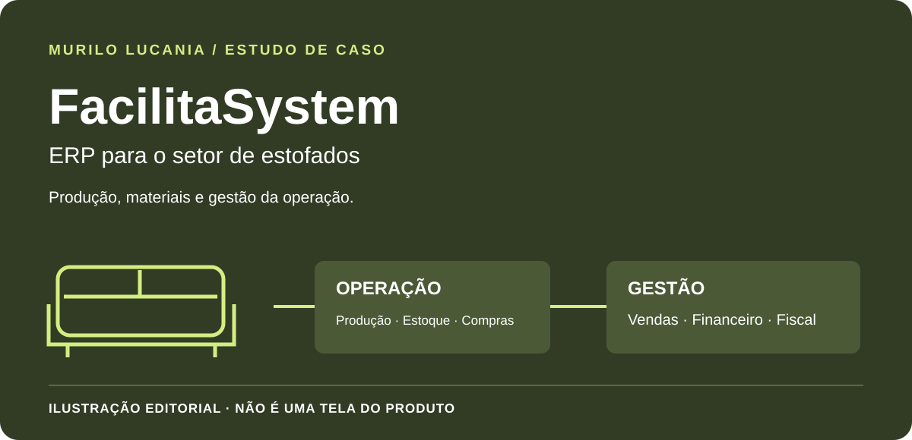

# FacilitaSystem · ERP para o setor de estofados

*Capa editorial deste estudo; não é uma captura da interface do FacilitaSystem.*

**Meu papel:** fundador e criador, com atuação na concepção, direção do produto, desenvolvimento, integração e evolução técnica.

## Segmento e problema

O FacilitaSystem é voltado ao **setor de estofados**. A gestão precisa relacionar produção, materiais, estoque, compras, vendas e financeiro. Quando essas informações ficam isoladas, acompanhar um pedido e suas consequências na operação exige conciliação entre várias áreas.

## Proposta do produto

Reunir os processos da empresa em um ERP orientado à operação de estofados, conectando os módulos de gestão e os fluxos industriais. O escopo inclui produção, estoque, compras, vendas, financeiro, operações fiscais e integrações com marketplaces.

## Visão da operação

| Área | Questão de negócio |
| --- | --- |
| Compras e estoque | Relacionar os materiais disponíveis às necessidades da operação. |
| Produção | Acompanhar a execução e sua relação com os pedidos. |
| Vendas e financeiro | Conectar o compromisso comercial aos registros de gestão. |
| Fiscal e integrações | Manter os processos conectados aos serviços necessários ao negócio. |

Essa tabela explica o problema atendido; não divulga um procedimento interno, uma regra fiscal ou um resultado comercial medido.

## Minha contribuição e critérios de engenharia

Minha atuação conecta entendimento do negócio, organização dos processos, desenvolvimento e evolução do produto. Os critérios de engenharia incluem responsabilidades claras entre os módulos, consistência dos registros, tratamento de integrações e manutenção verificável por testes.

## O que diferencia este projeto

O contexto é a operação de **estofados**, não uma apresentação genérica de ERP nem uma tela do MaxiSystem. FacilitaSystem e DecorSystem são projetos próprios; atender ao mesmo segmento não significa que suas interfaces e implementações sejam idênticas.

## Material educativo separado

O [Operational Flow Lab](../lab/README.md) é outro projeto, não uma versão pública, uma tela ou uma demonstração do FacilitaSystem. Código comercial, interfaces, cadastros e dados de empresas não integram este estudo.

[Comparar com DecorSystem](decorsystem.md) · [Conhecer MaxiSystem, voltado a móveis](maxisystem.md) · [Voltar aos seis estudos](README.md)

---

## English

**FacilitaSystem is an ERP project for the upholstery sector.** I am its founder and creator, working across product conception, business-process definition, development, integration, and technical evolution.

Its scope covers production, inventory, purchasing, sales, finance, fiscal operations, and marketplace integrations. This case explains the business context and engineering criteria without publishing proprietary workflows or claiming measured commercial outcomes.

FacilitaSystem and DecorSystem are distinct projects serving upholstery businesses; MaxiSystem targets furniture manufacturing. The cover is an editorial illustration, not a product screenshot. The separate public lab is not a FacilitaSystem demo.

[DecorSystem](decorsystem.md#english) · [All case studies](README.md#english)
