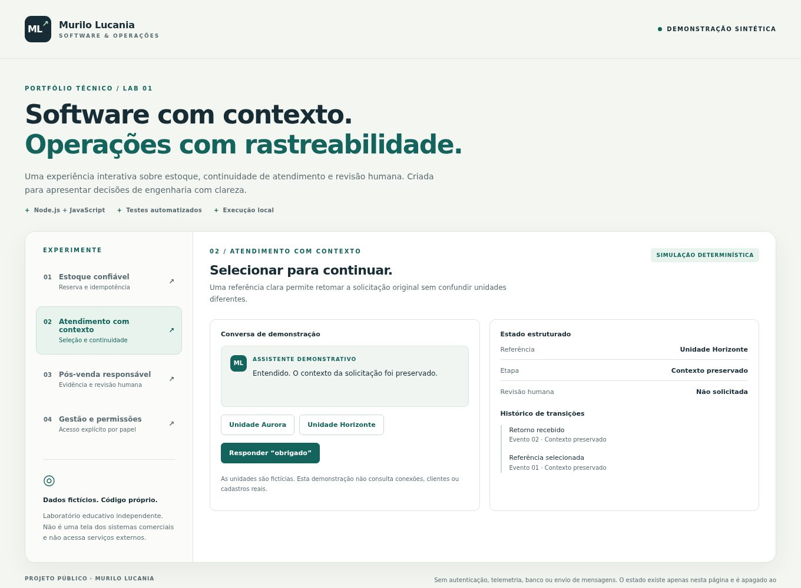

# Logos · Continuidade de atendimento com contexto

**Meu papel:** criador da solução e responsável por sua evolução no atendimento da MRL NET.

## Problema

Uma conversa não é uma sequência de frases isoladas. O cliente pode responder com poucas palavras, mudar de assunto, identificar uma referência ou retomar um pedido. O atendimento precisa preservar o que já foi informado e reconhecer quando falta contexto.

## Solução e decisões

A Logos integra atendimento, regras de domínio e canais de comunicação à plataforma MRL NET.

- representar assunto, etapa e resposta esperada de forma estruturada;
- separar classificação linguística da autorização para executar ações;
- preservar o episódio quando uma referência é selecionada ou o assunto muda;
- usar evidências do domínio para construir respostas;
- registrar decisões e encaminhar casos que exigem atendimento humano.

Esses princípios são apresentados em nível conceitual. Não são publicados conversas, cadastros, corpus interno, critérios financeiros ou regras específicas da operação.

## Resultado e evidência

O contrato técnico da solução documenta continuidade, contexto e limites entre domínios. O laboratório público oferece um recorte educativo: uma referência fictícia é selecionada e um retorno curto mantém essa referência, em vez de iniciar outro atendimento.

**A imagem é do laboratório, não da Logos.** A demonstração usa ações predefinidas e regras locais, sem conexão com WhatsApp, sem modelo generativo e sem envio de mensagens. Ela não reproduz todos os fluxos do produto.

[Executar a demonstração](../lab/README.md) · [Ler os testes de contexto](../lab/test/engine.test.mjs) · [Voltar ao portfólio](README.md)

---

## English

**Role:** solution creator and ongoing contributor to MRL NET's customer-service automation.

The central challenge is conversation continuity: short replies, reference selection, topic changes, and incomplete information must be interpreted within the current episode. Key design choices include structured context, domain boundaries, evidence-based responses, decision records, and human escalation.

The public lab demonstrates reference selection and contextual acknowledgement through predefined actions. It does not connect to WhatsApp, run a generative model, publish real conversations, or reproduce the full private product.

[Public sample](../lab/README.md#english) · [Tests](../lab/test/engine.test.mjs)
