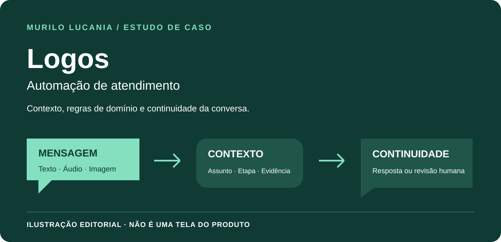

# Logos · Continuidade de atendimento com contexto

*Capa editorial deste estudo; não é uma captura da interface da Logos.*

**Meu papel:** criador da solução e responsável por sua evolução no atendimento da MRL NET.

## Problema

Uma conversa não é uma sequência de frases isoladas. O cliente pode responder com poucas palavras, mudar de assunto, identificar uma referência ou retomar um pedido. O atendimento precisa preservar o que já foi informado e reconhecer quando falta contexto.

## Solução e decisões

A Logos integra atendimento, regras de domínio e canais de comunicação à plataforma MRL NET.

- representar assunto, etapa e resposta esperada de forma estruturada;
- separar classificação linguística da autorização para executar ações;
- preservar o episódio quando uma referência é selecionada ou o assunto muda;
- usar evidências do domínio para construir respostas;
- registrar decisões e encaminhar casos que exigem atendimento humano.

Esses princípios são apresentados em nível conceitual. Não são publicados conversas, cadastros, corpus interno, critérios financeiros ou regras específicas da operação.

## O percurso do atendimento

| Momento | Responsabilidade da solução |
| --- | --- |
| Receber a mensagem | Relacionar texto, áudio ou imagem ao contexto disponível. |
| Compreender a solicitação | Identificar assunto, etapa e informações que ainda faltam. |
| Consultar o domínio | Usar dados e regras da plataforma, não suposições linguísticas. |
| Dar continuidade | Preservar a referência e a solicitação ao receber uma resposta curta. |
| Encaminhar | Registrar e transferir o caso quando exigir atuação humana. |

## Decisões de engenharia e compromissos

**Interpretação separada de autoridade:** reconhecer uma intenção não concede permissão para alterar dados ou executar ações. As precondições do domínio continuam necessárias.

**Contexto estruturado:** o assunto e a etapa orientam a próxima resposta. A mesma palavra pode ter sentidos diferentes conforme a pergunta anterior.

**Limites explícitos:** a resposta precisa ser sustentada pelas evidências disponíveis. Encaminhar uma dúvida é preferível a inventar um fato ou um efeito que não foi confirmado.

## Resultado e evidência

O contrato técnico da solução documenta continuidade, contexto e limites entre domínios. Este estudo descreve esses princípios sem expor interfaces, conversas de clientes ou regras privadas de execução.

## Material educativo separado

O [Operational Flow Lab](../lab/README.md) contém um exemplo independente de seleção de referência e continuidade, com [testes públicos](../lab/test/engine.test.mjs). É outro projeto, não uma versão pública, uma tela ou uma demonstração da Logos. Usa ações predefinidas e regras locais, sem WhatsApp, modelo generativo ou envio de mensagens.

[Conhecer o MRL Auth](mrl-auth.md) · [Conhecer a Bella IA](bella-ia.md) · [Voltar aos seis estudos](README.md)

---

## English

**Role:** solution creator and ongoing contributor to MRL NET's customer-service automation.

The central challenge is conversation continuity: short replies, reference selection, topic changes, and incomplete information must be interpreted within the current episode. Key design choices include structured context, domain boundaries, evidence-based responses, decision records, and human escalation.

The cover is an editorial illustration, not the Logos interface. A separate educational lab demonstrates reference selection through predefined actions; it is not a Logos demo. It does not connect to WhatsApp, run a generative model, publish real conversations, or reproduce the private product.

[Public sample](../lab/README.md#english) · [Tests](../lab/test/engine.test.mjs)
