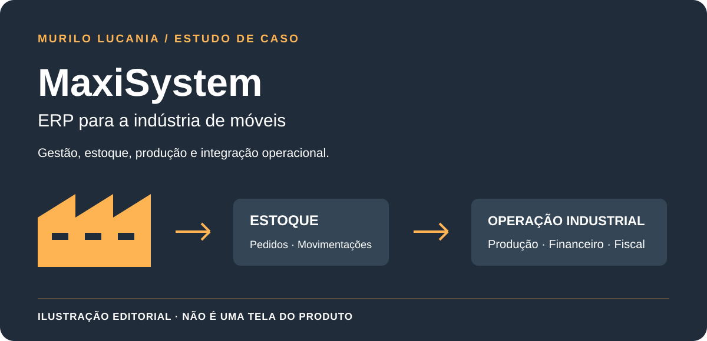

# MaxiSystem · ERP para a indústria de móveis

*Capa editorial deste estudo; não é uma captura da interface do MaxiSystem.*

**Meu papel:** fundador e criador do projeto, com atuação em concepção, desenvolvimento, integração e evolução técnica.

## Problema

Na **indústria de móveis**, estoque, pedidos, produção, financeiro, fiscal e canais de venda precisam compartilhar informações consistentes. Uma operação repetida, um saldo divergente ou uma etapa sem rastreabilidade pode repercutir em várias áreas do negócio.

## Solução e decisões

O MaxiSystem organiza esses processos em um ERP industrial. O recorte deste estudo é a combinação entre módulos de negócio e processamento rastreável:

- módulos com responsabilidades explícitas para estoque, pedidos, produção, financeiro e integrações;
- separação entre interface, serviços de aplicação e processamento em segundo plano;
- registro de movimentações e estados para acompanhar o percurso da operação;
- reconhecimento de operações repetidas em fluxos de integração;
- evolução por testes e publicação controlada.

Essa descrição é uma visão funcional e arquitetural de alto nível. Não apresenta regras comerciais, dados de empresas ou detalhes da infraestrutura.

## Visão do produto

| Frente | Responsabilidade na gestão |
| --- | --- |
| Estoque e pedidos | Relacionar movimentações, disponibilidade e demanda comercial. |
| Produção | Integrar o acompanhamento industrial aos demais processos. |
| Financeiro e fiscal | Conectar registros de gestão às operações da empresa. |
| Marketplaces | Integrar canais de venda sem perder a referência das operações. |

## Decisões de engenharia e compromissos

**Modularidade:** separar responsabilidades permite evoluir uma área sem concentrar todas as regras em um único serviço. As integrações entre módulos continuam exigindo contratos e testes.

**Processamento em segundo plano:** integrações podem levar mais tempo que a interação na tela. Separá-las da apresentação exige estados acompanháveis e tratamento de falhas, em vez de presumir conclusão imediata.

**Idempotência e rastreabilidade:** uma operação recebida novamente precisa ser distinguida de uma operação nova. Registrar sua referência permite investigar o percurso sem confundir tentativa e resultado.

## Resultado e evidência

A documentação técnica revisada descreve os módulos e sua integração operacional. O estudo público apresenta o problema e as decisões de engenharia, preservando a interface comercial e os dados das empresas. Não são divulgados indicadores de redução de custos, produtividade ou escala de produção sem medição publicável.

## Material educativo separado

O [Operational Flow Lab](../lab/README.md) contém um exemplo independente de reserva de estoque e [testes de repetição e conservação de saldo](../lab/test/engine.test.mjs). É outro projeto, não uma versão pública, uma tela ou uma demonstração do MaxiSystem.

[FacilitaSystem — estofados](facilitasystem.md) · [DecorSystem — estofados](decorsystem.md) · [Voltar aos seis estudos](README.md)

---

## English

**Role:** project founder and creator, spanning product conception, development, integration, and technical evolution.

MaxiSystem is an ERP for **furniture manufacturing**, coordinating inventory, orders, production, finance, fiscal workflows, and sales channels. FacilitaSystem and DecorSystem serve the upholstery sector as distinct projects. Selected design decisions include modular business responsibilities, background processing, traceable state transitions, and idempotent integration flows.

The cover is an editorial illustration, not the MaxiSystem interface. This case describes high-level engineering decisions; the commercial product remains private. A separate educational inventory sample tests stock conservation and repeated operations. It is not a MaxiSystem demo or evidence of quantified commercial gains.

[Public sample](../lab/README.md#english) · [Tests](../lab/test/engine.test.mjs)
