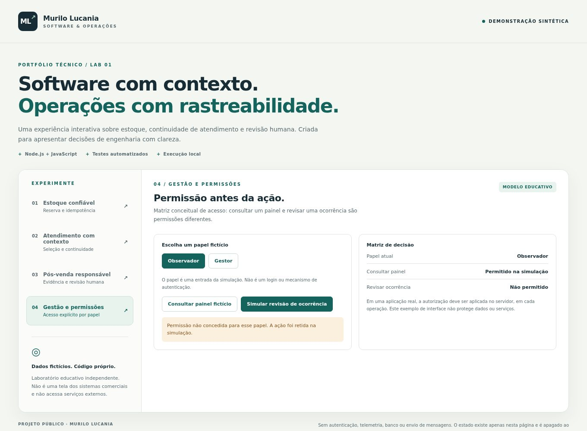

# MRL Auth · Gestão de provedor e controle de acesso

**Meu papel:** criador e responsável pela evolução técnica da plataforma no contexto da MRL NET, empresa que fundei.

## Problema

A operação de um provedor envolve clientes, planos, cobrança, autenticação, rede e ordens de serviço. Essas áreas precisam se relacionar sem confundir consulta, autorização e execução de uma ação.

## Solução e decisões

O MRL Auth reúne a gestão administrativa e as integrações de operação do provedor. A Logos participa como uma solução de atendimento integrada, apresentada em [estudo próprio](logos.md).

- organização de clientes, planos, financeiro e ordens de serviço;
- integração entre gestão administrativa e autenticação de acesso à rede;
- permissões por papel e verificação de autorização nas operações;
- separação entre regras de domínio, integrações e apresentação;
- registros, testes, verificações de saúde e procedimentos de recuperação para apoiar a manutenção.

O recorte público é o desenho das responsabilidades. Não são apresentados cadastros, valores, configurações de autenticação, equipamentos, endpoints ou topologia da operação.

## Resultado e evidência

A plataforma possui gestão e integrações documentadas. No laboratório público, apresento uma **matriz conceitual de permissões**, em que consultar um painel e revisar uma ocorrência são ações diferentes. Um papel não reconhecido não recebe acesso por conveniência.

**A imagem é do laboratório, não do MRL Auth.** Esse modelo em memória não autentica usuários, não protege um serviço real e não reproduz a implementação privada de autorização. Em produção, a autorização precisa existir no servidor.

[Executar a demonstração](../lab/README.md) · [Verificar permissões nos testes](../lab/test/engine.test.mjs) · [Voltar ao portfólio](README.md)

---

## English

**Role:** platform creator and technical contributor, within MRL NET, the company I founded.

MRL Auth connects ISP administration, customer management, plans, billing, authentication, service orders, and network operations. The case highlights explicit responsibilities, role permissions, domain boundaries, and maintainable operational workflows.

The public sample is a conceptual role-permission matrix. It is deliberately separate from the private platform and is not a real authentication or backend authorization implementation. No customer records, network configuration, endpoints, or topology are published.

[Public sample](../lab/README.md#english) · [Tests](../lab/test/engine.test.mjs)
