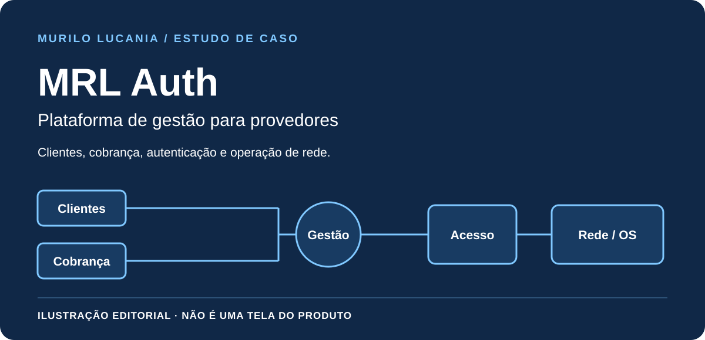

# MRL Auth · Gestão de provedor e controle de acesso

*Capa editorial deste estudo; não é uma captura da interface do MRL Auth.*

**Meu papel:** criador e responsável pela evolução técnica da plataforma no contexto da MRL NET, empresa que fundei.

## Problema

A operação de um provedor envolve clientes, planos, cobrança, autenticação, rede e ordens de serviço. Essas áreas precisam se relacionar sem confundir consulta, autorização e execução de uma ação.

## Solução e decisões

O MRL Auth reúne a gestão administrativa e as integrações de operação do provedor. A Logos participa como uma solução de atendimento integrada, apresentada em [estudo próprio](logos.md).

- organização de clientes, planos, financeiro e ordens de serviço;
- integração entre gestão administrativa e autenticação de acesso à rede;
- permissões por papel e verificação de autorização nas operações;
- separação entre regras de domínio, integrações e apresentação;
- registros, testes, verificações de saúde e procedimentos de recuperação para apoiar a manutenção.

O recorte público é o desenho das responsabilidades. Não são apresentados cadastros, valores, configurações de autenticação, equipamentos, endpoints ou topologia da operação.

## Visão do produto

| Área | Responsabilidade |
| --- | --- |
| Gestão administrativa | Clientes, planos e dados necessários à operação do provedor. |
| Financeiro e cobrança | Organização dos títulos e dos processos de pagamento. |
| Rede e autenticação | Integração entre a gestão e o acesso à conexão. |
| Ordens de serviço | Registro do trabalho operacional e atendimento técnico. |
| Atendimento | Integração com a Logos, que possui fluxos e responsabilidades próprios. |

## Decisões de engenharia e compromissos

**Gestão não é autorização:** consultar um cadastro não significa ter permissão para modificá-lo. A verificação precisa acompanhar a operação no servidor.

**Integração não é conclusão:** a plataforma se relaciona com serviços de rede. Acompanhar estado, falha e recuperação evita apresentar uma tentativa como efeito concluído.

**Operação sustentável:** testes, registros, verificações de saúde e procedimentos de recuperação fazem parte da evolução do produto, além das funcionalidades visíveis.

## Resultado e evidência

A plataforma possui gestão e integrações documentadas. Este estudo apresenta as responsabilidades administrativas e de operação de rede, sem publicar a interface comercial, cadastros ou a implementação privada de autorização.

## Material educativo separado

O [Operational Flow Lab](../lab/README.md) contém uma matriz conceitual de permissões com [testes públicos](../lab/test/engine.test.mjs). É outro projeto, não uma versão pública, uma tela ou uma demonstração do MRL Auth. O modelo em memória não autentica usuários nem protege um serviço real; em produção, a autorização precisa existir no servidor.

[Conhecer a Logos](logos.md) · [Voltar aos seis estudos](README.md)

---

## English

**Role:** platform creator and technical contributor, within MRL NET, the company I founded.

MRL Auth connects ISP administration, customer management, plans, billing, authentication, service orders, and network operations. The case highlights explicit responsibilities, role permissions, domain boundaries, and maintainable operational workflows.

The cover is an editorial illustration, not the MRL Auth interface. A separate educational lab contains a conceptual role-permission matrix; it is not an MRL Auth demo or a real authentication implementation. No customer records, network configuration, endpoints, or topology are published.

[Public sample](../lab/README.md#english) · [Tests](../lab/test/engine.test.mjs)
